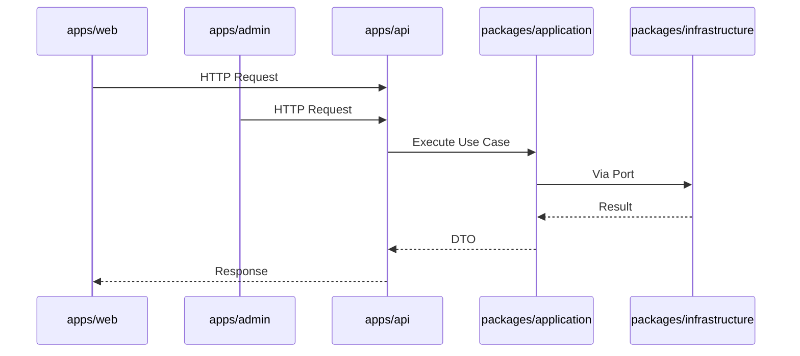

# ADR-003: Application Boundaries

**Status:** Vorgeschlagen (teilweise offen)  
**Datum:** 2026-07-14  
**Entscheider:** Lead Software Architect

## Kontext

RC Hub hat drei deployable Apps. Grenzen müssen klar sein, um Vermischung von Concerns zu verhindern.

## Entscheidung

### `apps/web` — Öffentliche Website

| Aspekt | Festlegung |
|--------|------------|
| Framework | Next.js 15 (App Router) |
| Zielgruppe | Endnutzer / Öffentlichkeit |
| Auth | Session-basiert über `@rc-hub/auth` (öffentliche Bereiche) |
| 3D/Motion | Three.js, R3F, GSAP, Framer Motion — **nur hier** |

**Verantwortung:** Marketing, öffentliche Inhalte, ggf. User-Portal  
**Verboten:** Admin-Funktionen, direkte DB-Zugriffe

---

### `apps/admin` — Admin Dashboard

| Aspekt | Festlegung |
|--------|------------|
| Framework | Next.js 15 (App Router) |
| Zielgruppe | Interne Administratoren |
| Auth | NextAuth mit erhöhten Rollen/Permissions |
| 3D/Motion | Nicht vorgesehen (Performance & Klarheit) |

**Verantwortung:** CRUD, Reporting, Konfiguration  
**Verboten:** Öffentlich zugängliche Routes ohne Auth-Guard

---

### `apps/api` — Backend API

| Aspekt | Festlegung |
|--------|------------|
| Framework | **OFFEN** — siehe Optionen unten |
| Zielgruppe | `web`, `admin`, externe Clients |
| Auth | API-Key / JWT / Session — **TODO** |

**Verantwortung:** REST/GraphQL Endpoints, Use Case Exposition  
**Verboten:** UI-Rendering, direkte Prisma-Calls (nur über Application Layer)

## API-Implementierungsoptionen (Entscheidung ausstehend)

| Option | Pro | Contra |
|--------|-----|--------|
| **A) Next.js Route Handlers** (eigenständige API-App) | Einheitlicher Stack, geteiltes Deployment | Next.js-Overhead für reine API |
| **B) Hono / Elysia auf Node** | Leichtgewichtig, schnell | Zusätzlicher Runtime-Kontext |
| **C) tRPC** | End-to-End Type Safety | Kopplung Frontend↔API, weniger für externe Clients |

→ **Empfehlung:** Option A für Konsistenz im Next.js-Ökosystem, sofern keine dedizierte Microservice-Architektur geplant ist.

**Status:** ⏳ Wartet auf Klärung → [TODO.md](./TODO.md#api-strategie)

## Kommunikationsfluss

## Konsequenzen

- Apps kommunizieren **nicht direkt** untereinander
- Shared UI nur zwischen `web` und `admin` über `@rc-hub/ui`
- API ist Single Entry Point für mutierende Business-Operationen

## TODO

- [ ] API-Strategie finalisieren (Option A/B/C)
- [ ] Auth-Strategie zwischen Apps abstimmen
- [ ] API-Versionierungskonzept (`/v1/...`)
