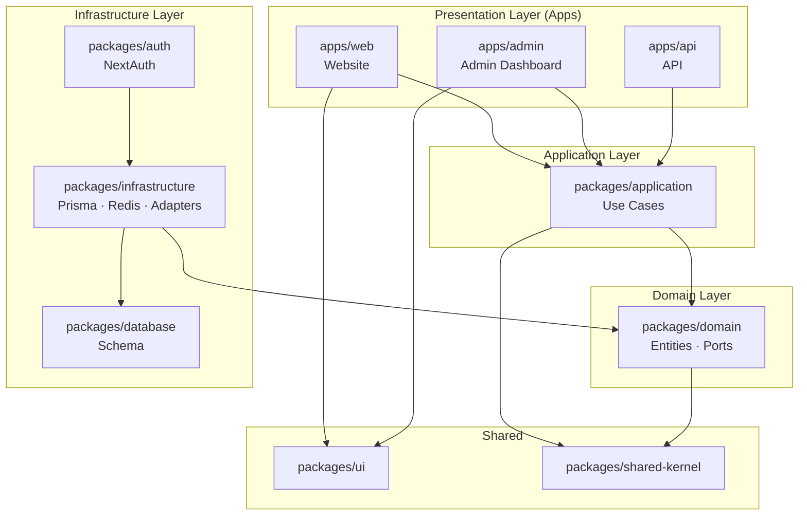

# RC Hub — Architektur

## Analyse: Ist-Zustand

| Aspekt | Status |
|--------|--------|
| Bestehender Code | ❌ Keiner — Greenfield |
| Datenbankschema | ❌ Nicht definiert |
| Deployment | ❌ Offen → siehe [TODO.md](./TODO.md) |
| Domänenmodell | ❌ Offen → siehe [TODO.md](./TODO.md) |

## Soll-Architektur



## Abhängigkeitsregel (Clean Architecture)

```
Apps → Application → Domain ← Infrastructure
```

- **Domain** kennt keine äußeren Schichten.
- **Application** definiert Use Cases und hängt nur von Domain-Ports ab.
- **Infrastructure** implementiert Ports — niemals umgekehrt.
- **Apps** sind dünne Composition Roots (Dependency Injection, Routing, UI).

## Technologie-Stack

| Bereich | Technologie | Status |
|---------|-------------|--------|
| Monorepo | Turborepo + pnpm | ✅ Struktur |
| Frontend | Next.js 15, React 19, TypeScript | 🔲 Scaffold |
| Styling | Tailwind CSS | 🔲 Scaffold |
| 3D / Motion | Three.js, R3F, GSAP, Framer Motion | 🔲 Website only? → TODO |
| Backend | Next.js API / dediziert | 🔲 Entscheidung offen → ADR-003 |
| ORM | Prisma | 🔲 Schema offen |
| Datenbank | PostgreSQL | 🔲 Docker bereit |
| Cache | Redis | 🔲 Use Cases offen → TODO |
| Auth | NextAuth | 🔲 Provider offen → TODO |
| Container | Docker | 🔲 Compose bereit |

## Architecture Decision Records

| ADR | Titel |
|-----|-------|
| [ADR-001](./ADR-001-monorepo-strategy.md) | Monorepo-Strategie (Turborepo + pnpm) |
| [ADR-002](./ADR-002-clean-architecture.md) | Clean Architecture Schichten |
| [ADR-003](./ADR-003-application-boundaries.md) | App-Grenzen (Web, Admin, API) |

## Offene Punkte

→ [TODO.md](./TODO.md)
